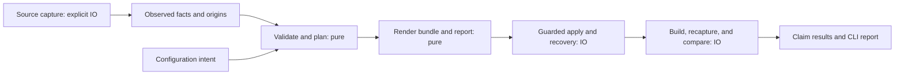

# Engineering roadmap

Deliver predictable migrations: unsupported semantics fail visibly, external work
has explicit limits, and interrupted output changes have a tested recovery path.
This is the next milestone after the required CMake and Gradle/Java fixtures.

This document owns implementation order and acceptance gates. The
[architecture guide](architecture.md) describes current behavior;
[CONTRIBUTING.md](../CONTRIBUTING.md) defines existing checks. Designs below are
proposals until their implementation PRs pass the stated gates. PR identifiers
such as R01 are work packages, not assigned GitHub pull request numbers.

## Baseline and evidence

The baseline is `d0add205b4734f69fa8f0afaaa75311be5b72d16`, inspected on
2026-11-07. The project has working vertical slices and is entering hardening.
It has nine Cargo crates, Rust 2024, a pinned toolchain, and Cargo/Bazel checks.

| Completed work                                                                                                                                                              | Evidence and remaining boundary                                                                                           |
| --------------------------------------------------------------------------------------------------------------------------------------------------------------------------- | ------------------------------------------------------------------------------------------------------------------------- |
| Rust modernization and typed Starlark generation, PRs [#1](https://github.com/albertocavalcante/rebaze/pull/1) and [#2](https://github.com/albertocavalcante/rebaze/pull/2) | Fallible structured rendering and syntax regressions; syntax alone does not establish build semantics.                    |
| Explicit discovery, [#4](https://github.com/albertocavalcante/rebaze/pull/4)                                                                                                | Replayable package observations; pkg-config capture/deadline limits apply per command, not to the whole migration.        |
| Managed dependency planning, [#5](https://github.com/albertocavalcante/rebaze/pull/5)                                                                                       | System/source/BCR planning and explicit build oracles; complete native target linkage remains open.                       |
| Runmux activation, [#6](https://github.com/albertocavalcante/rebaze/pull/6)                                                                                                 | Actual Linux ARM64 Cargo/Bazel execution; other native platforms require separate evidence.                               |
| Required CMake and Java migrations, [#7](https://github.com/albertocavalcante/rebaze/pull/7) and [#8](https://github.com/albertocavalcante/rebaze/pull/8)                   | Real CLI generation, original/generated builds and tests, and deliberate assertion failures for narrow supported subsets. |

The [final reviewed-head CI run](https://github.com/albertocavalcante/rebaze/actions/runs/42413913333)
passed both jobs and both required fixtures. The squash tree matches that head.
Native macOS ARM64 Java validation also passed. These are recorded results for
that tree; each implementation PR needs fresh evidence on its own final head.

| Evidence axis                   | Assessment | Next gap                                                                                                            |
| ------------------------------- | ---------- | ------------------------------------------------------------------------------------------------------------------- |
| Correctness                     | Partial    | Unknown native dependencies, normalized names, evaluation order, scopes, and configuration intent.                  |
| Recovery and resource use       | Partial    | Complete-batch recovery, concurrent changes, aggregate input limits, and build deadlines.                           |
| Compatibility                   | Partial    | Named fixtures work; broader source, File API, toolchain, and Bzlmod semantics remain unproven.                     |
| Integration                     | Partial    | Required first-party fixtures exist; optional corpora can skip, and external library consumers need stronger gates. |
| Delivery and operations         | Partial    | Runmux works for the reviewed workload; local checks, docs PR gates, and release identity need alignment.           |
| Documentation and API usability | Partial    | Contributor guides exist; public configuration/API promises need executable behavior checks.                        |

Since that baseline, [CI routing (#10)](https://github.com/albertocavalcante/rebaze/pull/10)
added lightweight checks for known repository Markdown, PR builds for published
site inputs, and checksum-verified Bun setup. Code, build/CI inputs, mixed changes,
and unknown paths retain full verification; documentation-only nightly ranges
skip platform builds. See the [runner runbook](operations/ci-runners.md) for routing
and recovery. This delivers part of D02; executable examples and consumer-install
checks remain open, as does D01's alignment of local recipes, hooks, and CI.

Source inspection identified the work below. Except where linked evidence says
otherwise, the proposed defect examples still need executable reproductions.
The historical [file-decomposition proposal](refactoring-plan.md) is superseded
by this behavior-driven sequence.

## Real-world migration validation

The comparison with [any2bazel](https://github.com/EngFlow/any2bazel/tree/af53b99b71a6238cdd0b4dca15dd20d429918871)
reinforces a missing evidence boundary: generating valid Starlark and building it
is weaker than independently comparing the original and generated builds.
Its deterministic differ and agent-assisted repairs are useful references;
its published case studies are upstream-reported results, not rebaze passes.

Use the following pinned project ladder. These versions are fixed comparison
inputs, not recommendations to downgrade a project's dependencies.

| Project / revision | Purpose | Admission and stronger completion gate |
| --- | --- | --- |
| [TinyXML2 11.0.0](https://github.com/leethomason/tinyxml2/tree/9148bdf719e997d1f474be6bcc7943881046dba1) | Small C++ library, executable tests, static/shared options; aligns with the existing Buildport pilot. | Compare source extraction and explicit configured File API capture separately. Build/run original and generated tests in Debug/Release, then exercise a downstream consumer. |
| [fmt 11.2.0](https://github.com/fmtlib/fmt/tree/40626af88bd7df9a5fb80be7b25ac85b122d6c21) | C++ usage requirements, compiled/header-only forms and configuration-sensitive flags. | Record exact enabled targets/options; first validate the compiled-library profile and downstream headers/defines. Header-only and shared profiles need separate evidence. |
| [zlib 1.3.1](https://github.com/madler/zlib/tree/51b7f2abdade71cd9bb0e7a373ef2610ec6f9daf) | C build, configured headers, feature probes and static/shared variants. | Generated headers and selected compiler/configuration must be preserved or explicitly refused; a successful existing BCR dependency fixture is not a zlib migration pass. |
| [spdlog 1.15.3](https://github.com/gabime/spdlog/tree/6fa36017cfd5731d617e1a934f0e5ea9c4445b13) | External fmt dependency and public compile definitions. | Add after fmt's profile works; require the declared dependency variant and a downstream consumer. |
| [Mockito 5.20.0](https://github.com/mockito/mockito/tree/3a1a19ee40f1234048880393343405046fc3fa60) | Real Gradle plugins, dependency scopes and test/runtime instrumentation. | Begin with admission/refusal analysis. Its build is outside the current literal Java/JUnit4 fixture contract; do not claim compatibility from parsing project names. |

Larger projects such as Abseil, RE2, or Ladybird follow demonstrated progress on
these profiles. Project count alone is not a compatibility measure. Keep a small
first-party fixture for each discovered defect so ordinary regression checks do
not need every external checkout or private tool.

### Record each boundary

For every selected project, retain its URL, tag and full commit, clean-input
inventory/hash, tool revision and binary hash, OS/architecture, compiler identity,
configuration, enabled options/targets and exact commands. A tag or commit does
not identify a dirty source tree. Keep source and generated workspaces separate.

Record source admission, configured capture, planning, rendering, original build,
generated build, test discovery/execution, downstream consumption and independent
comparison as separate results. Distinguish unsupported input, infrastructure or
tool failure, semantic mismatch, and missing evidence. A failed baseline cannot
validate a migration; an empty or unexecuted test set cannot establish test parity.

File API fragments are shell text and structured observations, not a replacement
for the complete ordered compiler command. Combine them with an explicit compile
capture where needed. Preserve target ownership, configuration, raw evidence and
unknown facts. Compare with Buildport as an optional independent experiment and
any2bazel where its supported profile applies. Public required gates must remain
reproducible without private libraries or machine paths.

Use explicit wall-clock, retained-log, disk and concurrency budgets. An exceeded
experiment budget is an incomplete result. Never lower runmux storage gates,
terminate unrelated jobs, or share a writable output root between runs. Keep
third-party suites out of ordinary library tests; explicitly selected integration
runs fail on missing inputs/tools and retain failed logs. Required existing CLI
fixtures remain required.

### Learn from failures

For each choke point, record the first failed boundary, the observed behavior,
expected supported/refused outcome, evidence and smallest owning change. Separate
an honest refusal from a bug that accepts or drops required semantics. Fix the
minimal reproducer, obtain independent review, and rerun the original case on the
final source. Do not patch the comparison oracle to accept the candidate.

A profile passes only when its nonempty required claims are satisfied. Deliberate
damage to a dependency, owning-target flag, include resolution, configuration or
test behavior must be detected by the relevant gate. Report accepted differences
and exclusions with reasons; a zero-error scoped diff is not universal equivalence.
No result in this selection table is a completed migration claim by itself.

## Milestone contract

Complete this milestone when all five phase gates pass for the documented subset:

1. Every required input fact is represented, deliberately omitted with a reason,
   or rejected before applying generated output. Unknown never means empty.
2. Pure planning/rendering returns files and diagnostics without host probes,
   writes, terminal output, or hidden configuration lookup.
3. Failed/interrupted application preserves recoverable content or reports an
   explicit conflict. Recovery never overwrites an intervening user edit.
4. Input, expansion, graph, output, and external-process work has documented bounds.
5. Independent source/destination checks support each compatibility claim, and a
   clean checkout can reproduce contributor and release gates.

Per-file rename atomicity does not imply complete-batch atomicity or durability.
A successful build does not establish test parity or reusable-library semantics.
Executing source build scripts remains an explicit trusted operation, not a
sandbox guarantee supplied by this milestone.

## Design boundaries

### Data flow and ownership

Keep source models alongside any derived facts. CMake source syntax, configured
File API data, pkg-config observations, and Gradle metadata have different
completeness. Record that difference rather than forcing them into one graph.

| Boundary                           | Intended owner                                                  | Contract                                                                                   |
| ---------------------------------- | --------------------------------------------------------------- | ------------------------------------------------------------------------------------------ |
| Source reading/extraction          | Existing source crates                                          | Return observations, origins, and unsupported forms under explicit read limits.            |
| Native/JVM preparation             | `rebaze-bazel` planning modules                                 | Validate target identity, dependency meaning, configuration, and destination capabilities. |
| Starlark construction              | `rebaze-starlark`                                               | Serialize typed values through one escaping implementation; keep helper source static.     |
| Bundle and lowering report         | Initially `rebaze-bazel`                                        | Deterministic output paths/bytes, diagnostics, assumptions, mappings, and required checks. |
| Apply/recovery                     | Initially a dedicated module in `rebaze-bazel`, invoked by core | Stage, check expected state, apply conservatively, and expose recovery outcomes.           |
| Process adapters and orchestration | `rebaze-core`                                                   | Explicit program/cwd/environment/deadline/output policy; no probing during rendering.      |
| Presentation                       | `rebaze-cli`                                                    | Print previews and reports; choose exit status from structured outcomes.                   |

These are ownership directions, not implemented API names. Keep compatibility
wrappers while migrating callers where practical. Document deliberate API changes.

### Typed contracts

Introduce private validated values before exporting new public types:

- Keep logical target identity, native producer identity, and content digest distinct.
- Separate Starlark identifiers, Bazel labels/module names, Gradle project paths,
  source-relative paths, and output-relative paths. Their grammars differ.
- Preserve dependency scopes and ordered arguments; deduplicate only values whose
  semantics permit it.
- Represent mapped, intentionally omitted, unresolved, and unsupported outcomes
  explicitly. Do not encode decisions as comment strings.
- Require deserialization to enforce the same invariants as constructors.
- Keep observed facts, inferred facts, policy choices, and verification results
  separate. Carry source location/native ID and configuration when available.

A generated bundle describes intended output, not successful application. A
lowering report describes supported transformations, not successful verification.
A migration report combines actual stage results without promoting missing checks.
Begin with passed/failed/unknown claim results and a nonempty required claim set.
Allow not-applicable only when the selected profile justifies it.

### Buildport and IR research

Buildport's observation, fact, decision, lowering, and verification layers are the
comparison baseline. Its inspected prototype contains a pilot CMake-to-Bazel
generator and recorded Debug/Release results despite stale overview text claiming
otherwise. Its broader interchange design remains partly proposed. Recorded
single-project/macOS results do not establish general portability, and its
implemented guarded apply is single-file; complete-batch recovery is modeled.

Rebaze remains a Rust converter with its documented source subsets. Use Buildport
as an explicit independent comparison experiment, not a production subprocess
dependency or an inaccessible required CI input. Do not copy private source or
require private checkout paths in public tests. Public gates need checked-in
first-party fixtures or openly obtainable, revision-pinned inputs.

Borrow stable identity/request-context separation from
[Swift Build PIF](https://github.com/swiftlang/swift-build/blob/699c510d9682322f5d1c445043bc2df0a8b6a530/SwiftBuild.docc/Core/project-interchange-format.md),
and explicit legality checks from [MLIR conversion](https://mlir.llvm.org/docs/DialectConversion/).
These are design references, not new runtime dependencies. Preserve native
information that cannot be translated, but never claim that preserving it makes
the destination implement it. Full bidirectional synchronization remains deferred.

### Crate and dependency decisions

| Candidate                            | Decision for this milestone                               | Extraction gate                                                                                                                 |
| ------------------------------------ | --------------------------------------------------------- | ------------------------------------------------------------------------------------------------------------------------------- |
| `rebaze-input`                       | Shared counted IO and root authority for CMake/configuration. | Multiple real readers share validated budgets and capability policies; parsing remains a separate pure boundary. |
| `rebaze-output`                      | Define bundle/apply boundaries in existing modules first. | Native and Java callers share a stable tested recovery API; extraction removes coupling without importing parsers or renderers. |
| `rebaze-bazel-types`                 | Conditional small shared library.                         | Generation and standalone Bzlmod need identical validated primitives without pulling HTTP/runtime dependencies into rendering.  |
| `rebaze-process`                     | Start as `rebaze-core::process`.                          | Multiple consumers demonstrably need the same stable process contract.                                                          |
| `rebaze-ir`                          | Deferred.                                                 | Field comparison and real consumers show duplicated semantics that a shared model actually removes.                             |
| Another Starlark serializer/full AST | Deferred.                                                 | A concrete required expression or preservation/editing operation exceeds existing typed Serde models.                           |
| Shared fixture helpers               | Development-only module first.                            | Repeated harness code warrants reuse without increasing consumer installation cost.                                             |

Reuse Tokio and tempfile where they fit. Evaluate property-testing or
directory-relative filesystem dependencies only against a concrete failing case.
Review MSRV, dependency footprint, and matching Cargo/Bazel declarations and locks.
Do not change the compiler floor merely to follow an upstream release.

## Phase order and PR dependencies

| Phase                       | Work packages | Outcome                                                            | Completion gate                                                                |
| --------------------------- | ------------- | ------------------------------------------------------------------ | ------------------------------------------------------------------------------ |
| 1. Explicit semantics       | R01–R04       | No silent loss; one bundle/report boundary.                        | Regressions reject ambiguity or preserve behavior before output application.   |
| 2. Recoverable application  | R05–R06       | Interrupted writes have a conservative recovery protocol.          | Injected failures/crashes preserve recoverable data and expose conflicts.      |
| 3. Bounded work             | R07–R09       | Hostile inputs and stalled tools cannot grow work without a limit. | Boundary ladders and legitimate large cases demonstrate each documented bound. |
| 4. Stronger native evidence | R10–R11       | Usage and compiler intent survive a real downstream consumer.      | Independent build/capture tests detect deliberate semantic damage.             |
| 5. Repeatable delivery      | D01–D03       | Local, CI, docs, and release evidence agree.                       | A clean checkout reproduces checks and packages the selected tested revision.  |

R01–R04 have landed, as have R05's single-file protocol and R06a's existing-parent
batch library. These application APIs remain opt-in: missing-parent handling,
qualified metadata and core integration still gate R06 completion. R07a's borrowed
CMake parser limits have landed in [#21](https://github.com/albertocavalcante/rebaze/pull/21).
R07b's shared bounded input reader and CMake/configuration consumers landed in
[#22](https://github.com/albertocavalcante/rebaze/pull/22). R07c adds counted directory
traversal and Gradle consumers. Remaining readers, evaluation, output and
whole-operation limits are still open.
D01's documentation/compiled-input routing correction landed in
[#19](https://github.com/albertocavalcante/rebaze/pull/19); local-tool alignment and
the broader delivery gates remain open.

R05 needs R04; R06 needs R05. R07/R08 can start after R04 but must land without
invalidating the apply protocol. R09 is an independent standalone-library slice.
R10 uses R03/R04 and the process/budget contracts from R07/R08. R11 begins with
field mapping after R04 and runs its full comparison after R10. D01/D02 may land
independently; D03 is a publication prerequisite, not permission to publish.

Do not create a stack spanning all phases. Land a focused PR, refresh the
baseline, and carry forward only the decisions its evidence supports. Use relative
effort estimates only after the first reproductions; no calendar promise is made.

## Phase 1: stop silent semantic loss

### R01 — Reject unresolved native dependencies and target collisions

Implemented: native preparation rejects unresolved required links and mapping
comments, validates production/test output names and alias graphs, and resolves
exact per-target dependency edges once. Typed mapping/omission decisions and CLI
preservation regressions cover these failures. R01's implementation is in place;
broader usage requirements and ordered compiler/linker semantics remain R10 work.

**Original problem:** dependency mapping returned TODO strings that generation
filtered out. Normalized names also silently dropped libraries such as
`foo-bar` versus `foo_bar`.
See [mapping](../crates/rebaze-bazel/src/config.rs) and
[native generation](../crates/rebaze-bazel/src/cmake_generator.rs).

**Work:** introduce explicit mapping outcomes and one production/test symbol
table. Preserve deliberate ignore policy with a reason. Resolve aliases with
cycle/ambiguity checks. Reject unresolved required links before discovery/writes.
Remove attachment of every managed alias to every target only when per-target
edges have a faithful replacement; do not strand existing valid mappings.

**Gate:** fail-first regressions cover unknown imported targets, name collisions,
ambiguous aliases, and unrelated targets needing different dependencies. Existing
valid managed-strategy cases and both CLI migration fixtures pass.

**Compatibility:** unresolved dependencies become visible errors. Explain the
mapping needed to proceed; do not provide an implicit permissive mode.

### R02 — Make configuration intent observable

Implemented in PR #14: strict field/format handling, fallible project loaders,
profile-specific support checks, root visibility and language defaults. Reserved
filter/header/system-linkopts overrides fail explicitly; Gradle Java and bazelle
reject non-default settings. Canonical public TOML examples are validated offline.
Independent final-head review, required CLI fixtures, mixed-language compiler
oracle and CI passed. Full compiler semantics and label validation remain open.

**Work:** inventory every public setting as implemented, unsupported, or deprecated.
Wire documented filters/defaults to generation or reject unsupported non-default
values. Test visibility and language defaults. Define precedence for flat/nested
configuration and reject typos. Deprecate invalid-config-to-default convenience
loaders after checking callers. State which settings apply to JVM generation.

**Gate:** each documented setting changes the intended output or returns an
explicit unsupported error. Malformed files never silently activate defaults.
Defaults retain existing supported behavior unless the PR documents a correction.

### R03 — Define the accepted CMake evaluation subset

Implemented in PR #15: source extraction observes supported changes in statement
order and captures isolated child contexts. Unsupported source evaluation blocks
native preparation; required missing/repeated listfiles fail visibly. Independent
review, native temporal/scope and refreshed File API oracles, and required final-head
CI passed. The source profile is deliberately narrow; complete per-target compiler
and usage semantics remain R10 work.

**Work:** process supported variable changes in statement order. Test an early
`add_library` between two assignments and directory-scope inheritance. Recognize
conditional/function/loop constructs that require evaluation and reject them for
migration rather than extracting their bodies as unconditional targets. Treat
missing required subdirectories as errors. Keep syntax parsing useful separately.

**Gate:** compare temporal-variable and scope cases against native CMake. Dynamic
forms either use explicitly selected configured File API evidence or fail before
output writes. No general CMake interpreter is required. Generated-source and
ambiguous-configuration behavior stays explicit.

### R04 — Return bundles, diagnostics, and stage reports

Implemented in PRs #16 and #17 with independent exact-head review, baseline
regression evidence, native CMake/Bazel oracles and required Linux CI including
Java migration. Core returns structured stages, CLI-owned previews and mandatory
build claims; missing/empty evidence remains unknown. Configured capture records
actual root/configuration and rejects foreign source roots. Journaled batch
application and shared process budgets remain R05/R06 and R08 work.

**Work:** replace bare output maps at the orchestration boundary with a validated,
ordered bundle and lowering report. Add origins and stable diagnostic categories
where R01–R03 need them. Keep expected destination state outside pure rendering.
Move preview printing to the CLI and return structured stage results from core.
Retain wrappers for existing generator consumers when practical.

**Gate:** identical inputs produce identical paths/bytes and stable report data.
Pure generation performs no IO/logging. Failed planning returns no applicable
bundle. Preview has a documented effect boundary and does not execute builds or
apply output; any explicit host discovery remains visible and bounded. Test
missing mandatory claim results as unknown, including an empty required set.

## Phase 2: make output application recoverable

### R05 — Guarded single-file apply and recovery

The opt-in Linux/macOS library API separates captured baseline and explicit
POSIX metadata intent
from pure generation, retains originals, and uses no-clobber renames for install
and recovery. See the [protocol and limits](guarded-application.md). Core's default
writer is unchanged pending R06; full metadata preservation is not claimed.
Independent review, mutation checks and required CI are part of the gate below.

**Work:** define expected absent/present state, baseline digest, intended bytes,
permissions, and ownership. Journal intent before replacement. Stage new content,
move the current destination aside, and verify the bytes actually moved. Install
without clobbering a recreated destination; restore conservatively on conflict.
Use a cooperative lock and account separately for uncooperative changes.

Bind the journal to the canonical root, schema, plan identity, and confined paths.
Reject malformed or escaping recovery records. Preserve recoverable copies until
completion is verified. Propagate sync/write/recovery failures with the location
of retained content. Specify metadata and filesystem/platform assumptions.

**Gate:** deterministic hooks and real-process interruption tests cover stale
baseline, save-between-check-and-write, recreated path, failed sync/install,
recovery interruption, symlink changes, and permission preservation. Recovery is
idempotent and never replaces a user's intervening content. A model-derived test
must exercise the implementation; model checking alone is insufficient.

### R06 — Complete-batch staging and conservative recovery

The opt-in existing-parent library slice stages complete batches and supports
forward recovery with per-output conflict evidence; see the
[protocol](guarded-application.md). Core integration, missing-parent ownership,
safe default metadata policy, post-build reports and external Bazelle boundaries
remain open. The complete R06 gate is not met by the library slice alone.

**Work:** stage the complete bundle before the first destination change. Record
per-file progress durably and reconcile journal plus filesystem after a crash.
Define allowed stopping outcomes: all intended files applied, baseline restored,
or an explicit conflict with retained recovery data. Do not promise observers
cannot see an intermediate batch. Protect journal cleanup and newly created
directories from deleting unrelated files.

Route native and JVM output through this API. Audit Bazelle generation and direct
scaffolding writes: stage them through the protocol or retain an explicit narrower
contract. Do not advertise transaction-wide safety for uncovered writer paths.

**Gate:** fail the Nth stage/replacement and interrupt each durable transition.
Recover in a fresh process, including failures during rollback. Cover mixed
existing/new files, disk-full injection, metadata, concurrent edits, and malformed
journals. Define post-build failure separately: retain inspectable output and
report recovery options; never silently restore over subsequent edits.

## Phase 3: bound input and external work

### R07 — Input, traversal, expansion, and output budgets

The borrowed CMake parser now has validated byte/recursive-scope profiles and
explicit exhaustion diagnostics. Grammar scopes are shared across recursive
families and released on backtracking. This initial slice does not complete R07:
CMake source capture now has counted reads, root confinement and shared byte,
file-attempt, operation and path-depth budgets through `rebaze-input`. Both TOML
configuration loaders also use bounded regular-file reads. Gradle capture now
shares the reader across modules, source enumeration, complete test sources and
its Maven lock. Directory entry and module-count budgets bound wide projects;
borrowed Gradle/Java lexing has an independent byte cap. File API/other readers,
evaluation/expansion, diagnostics and output budgets remain open. Native syntax and recorded corpus
comparisons are separate from migration or compiler-equivalence claims.

**Work:** add typed limits for file and aggregate bytes, file/project count,
recursion/token/node count, variable expansion, diagnostics, and generated output.
Use counted reads, not metadata size alone. Reject special files before blocking
reads and enforce limits while reading. Define root confinement and external-path
policy for CMake traversal and all source/configuration/lock readers.

Choose defaults from recorded supported workloads. Avoid overflow, quadratic
error construction, and deep recursive cleanup. Keep native/JVM adapters thin;
do not introduce a parser framework to share a counter.

**Gate:** test below, at, and above each bound, independently for depth and width.
Large legitimate fixtures pass. Changing file size after inspection cannot bypass
read caps. Rejections preserve existing generated output and identify the exhausted
budget. Fuzzing supplements these magnitude regressions rather than replacing them.

### R08 — Shared bounded process execution in core

**Work:** use an explicit request for executable, argv, cwd, environment policy,
stdin, deadline, and output handling. Migrate version probes, CMake, Bazel, Bazelle,
and pkg-config without losing current discovery behavior. Check Bazel version
from the target project context and perform feasible tool preflight before apply.

Drain both streams without unbounded memory. Bound retained logs while supporting
streaming progress. Separate probe deadlines from build deadlines and add a
whole-operation budget. Define cancellation, direct-child reaping, and descendant
containment per platform. Preserve unrelated Bazel servers and processes.

**Gate:** controlled helpers hang, flood each/both streams, fail startup, exit
unsuccessfully, and leave inherited pipes open. Verify deadline/cancellation
behavior and cleanup. Environment/cwd tests prevent hidden user configuration
from changing selected tools. Existing required build fixtures still pass.

### R09 — Standalone Bzlmod network and graph limits

**Work:** cap decompressed response bytes and cache entries/bytes. Bound total
resolution nodes/edges/requests/time as well as request timeout and concurrency.
Validate coordinate components before URL construction. Replace unbounded
all-path enumeration with a bounded API that reports truncation or limit errors.
Avoid call-stack dependence in deep graph operations.

**Gate:** mock HTTP and synthetic graph tests cover compression expansion,
wide/deep graphs, exponentially many paths, retries, cancellation, and legitimate
large inputs. Define lockfile schema/version and unknown-field policy before
round-trip claims; unsupported schemas must not overwrite existing files.
Keep standalone consumers independent of migration CLI dependencies.

## Phase 4: prove stronger native semantics and reuse

### R10 — Preserve native usage requirements and compiler intent

Split into a model/lowering PR and an oracle PR if review scope becomes too large.
Preserve public/private/interface requirements, target ownership, per-configuration
settings, and relevant per-source distinctions. Diagnose unsupported generated
inputs instead of dropping them. Use explicit source/File API evidence; missing
scope is unknown rather than automatically public.

Preserve raw compiler/linker argument order. Interpret only documented families
against named toolchain defaults; retain/refuse unknowns explicitly. Do not reuse
a GCC include-order model for Clang without conformance evidence. Keep translation
and compiler/toolchain modernization as separate changes. Any tolerated difference
names its target, configuration, reason, and supporting evidence.

**Gate:** a downstream consumer distinguishes public/private/interface macros and
headers. Competing standards, define/undefine order, include collisions, repeated
link inputs, and one source compiled under different targets/configurations have
independent expected results. Keep failed or unsupported configurations visible.

If fixtures require `select` or concatenation, add narrow typed expressions in
`rebaze-starlark`; reject uncaptured configurations explicitly. Test factoring
against each original ordered sequence, including repeated multi-token options.
Continue complete-file parser checks and real Bazel builds. A full AST rewrite
and automatic support for all configurations are outside this PR.

### R11 — Compare the native slice with Buildport

**Work:** first map fields and evidence levels between native source models,
prepared plans, explicit observations, and Buildport captures. Distinguish
implemented contracts from proposed correspondence/complement machinery.
Record immutable tool/repository/input identities and the selected claims.

Run the actual rebaze CLI on a small first-party C++ library and downstream
consumer. Independently recapture original CMake and generated Bazel builds.
Use Buildport as an additional explicit experiment where available. A public,
reproducible oracle in this repository remains the required gate; unavailable
private tooling is reported separately and cannot yield a claimed comparison pass.
Do not weaken checks to accept the generated candidate.

**Gate:** selected target/compile/link/test claims agree for the documented
profile, and deliberate dependency/scope/flag/configuration damage is detected.
Report unknowns and verifier blind spots, including visibility/link ordering.
Only extend to pinned TinyXML2 when its required semantics are supported.

**Reuse decision:** compare duplicated interpretation, diagnostic quality, consumer
dependencies, and integration cost. Extract shared contracts only if this removes
real duplication without losing native facts. A failed abstraction experiment may
legitimately conclude that separate models with shared fixtures are preferable.
JVM is a later domain-specific comparison, not an inferred C++ compatibility claim.

## Phase 5: make delivery repeatable

### D01 — One contributor check contract

Align Just recipes, hooks, and CI around the same underlying checks. Name fast
local checks and explicit integration checks separately; `just check` must state
its exact coverage. Required selected tools fail if absent. Include the existing
shell/Python/workflow/Buildifier policies and enforce the commit subject limit.

**Gate:** clean-checkout execution matches documented CI coverage. Verify failure
when a selected tool is missing and ensure ordinary library tests remain offline.
Do not remove required integration coverage to make the command cheaper.

### D02 — Documentation and consumer drift gates

Pin the Bun runtime, build site changes on PRs, and check repository Markdown
links and executable first-run examples. Keep README support claims concise and
link to contributor procedures. Update architecture only when behavior lands;
mark roadmap packages complete only with linked evidence. Make optional corpus
availability explicit, with immutable revisions and visible skips.

**Gate:** changed examples execute for their advertised subset; site/repository
links pass. A selected required fixture/corpus fails on missing inputs. Consumer
package/install checks prove new library boundaries stay lean and independently
usable without local workspace replacements.

### D03 — Release source identity and packaging

Make manual tag selection determine and verify the checked-out build revision.
Pass dispatch input as data, not interpolated shell source. Consolidate duplicated
release/nightly packaging where it reduces drift. Use qualified user-space
build environments instead of adding administrator provisioning. Reconcile
licensing with shipped license/notice files and correct migration support claims.

**Gate:** a nonpublishing release rehearsal records the selected tag, source SHA,
checks, targets, artifact contents, and checksums. Cross-compilation is labeled
separately from native execution. Tag/source mismatch aborts before publication.
Publication remains a separate explicitly scoped action.

Keep runmux's existing fork approvals, read-only tokens, image/tool pins,
executable temporary storage, hosted fallback, and separate host/engine disk
gates. Follow the [runner runbook](operations/ci-runners.md). Do not raise host
concurrency or relax storage gates without measured workload/headroom evidence.

## Validation and landing contract

Every implementation PR follows [CONTRIBUTING.md](../CONTRIBUTING.md) and
[REVIEW.md](../REVIEW.md). Include a base/head reproduction for a behavior fix;
new APIs require the original observable reproduction when base compilation is
impossible. Keep ordinary unit/property tests separate from explicit external
oracles. Record actual skips, missing tools, and platform limits.

For repaired guards, add focused mutation checks with an independent canary.
Use persisted fuzz seeds for parsers and explicit size/depth ladders for resource
limits. Expected results come from specifications, independent tools, or recorded
predictions, never only from the candidate generator's own output.

Require complete final-diff independent review and follow-up after fixes. Record
reviewed SHA, findings, repairs, checks, failure/recovery evidence, and remaining
limits. Required checks must pass on the final reviewed head. Squash merge with a
handcrafted Conventional Commit, verify the target commit, and clean only proven
merged task branches/worktrees and owned disposable artifacts.

## Decisions to close in their owning PRs

| Decision                    | Proposed default                                                                | Evidence needed before commitment                        |
| --------------------------- | ------------------------------------------------------------------------------- | -------------------------------------------------------- |
| Unknown native dependency   | Reject required unresolved intent; retain explicit intentional omissions.       | R01 regression and migration notes.                      |
| Configuration compatibility | Preserve implemented defaults; reject unsupported non-default intent.           | R02 field inventory and behavior matrix.                 |
| Batch recovery              | Journaled recovery with explicit conflict outcomes; no observer-atomic promise. | R05/R06 failure traces and platform assumptions.         |
| Resource defaults           | Configurable validated bounds based on supported workloads.                     | R07–R09 workload sizes and boundary results.             |
| Cross-product reuse         | Internal adapters and shared fixtures first.                                    | R11 concrete consumer and complexity comparison.         |
| New public/wire API         | Delay until an actual persistence or external-consumer need.                    | Compatibility fixtures, ownership, and evolution policy. |

## Deferred work

Maven migration, Android/Kotlin sources, arbitrary CMake/Gradle interpretation,
remote execution/action closure, general bidirectional synchronization, BUILD-file
editing with formatting preservation, and a public universal build IR remain
outside this milestone. Broad crate/file splitting, wholesale dependency upgrades,
and performance rewrites need their own consumer or measurement evidence.
